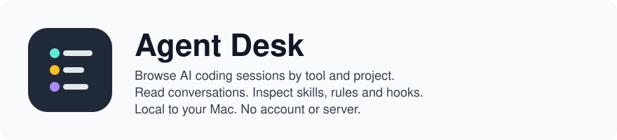
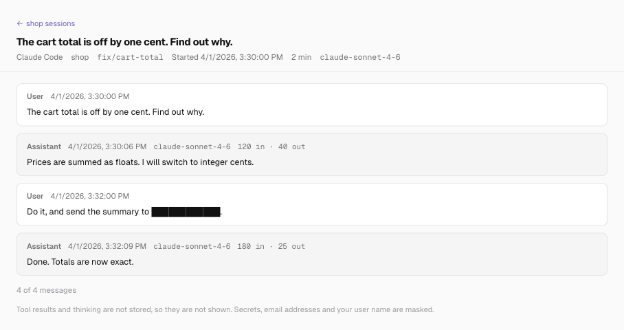

<picture>
  <source media="(prefers-color-scheme: dark)" srcset=".github/assets/banner-dark.svg">
  
</picture>



[](LICENSE)
[](#quick-start)
[](package.json)

Find your past AI coding work without digging through hidden folders. Agent Desk brings sessions from Claude Code, Cursor, GitHub Copilot, Antigravity, Codex and Kiro into one macOS menu bar app, with no account or server. Browse them by tool and project, search a project's sessions, read a past conversation with known secrets masked, and see the skills, rules and hooks your agents load alongside that work.

<a href="https://www.producthunt.com/products/agent-desk-and-session-intelligence?embed=true&amp;utm_source=badge-featured&amp;utm_medium=badge&amp;utm_campaign=badge-agent-desk-session-intelligence" target="_blank" rel="noopener noreferrer"></a>

Pair it with [Session Intelligence](https://github.com/tetriz-ai/session-intelligence) to turn those transcripts into insights about prompting, repeated corrections, outcomes and wasted effort.

Choose the path that fits what you want to do.

- **[Browse your own sessions](#quick-start):** build the app, choose a project, and reopen a conversation.
- **[Get insights from your sessions](docs/session-insights.md):** extract a transcript and analyze it with Session Intelligence and your own model.
- **[Build on the libraries](#the-packages):** use the session extractor or agent-file scanner in your own product.

## What it does

Start on Projects to find your work and read its sessions. Switch to Harness to inspect the instructions and tools your agents load.

- **Projects page:** the sessions per tool, under the project folders they ran in, with each project's stack tags.
- **A project's sessions:** that tool's sessions in the project, by date, each opening its masked conversation.
- **Harness page:** every skill, rule, hook, subagent and instruction file Claude Code, Codex, Cursor and Kiro load, from your home folder and every repo a session ran in.
- **File viewer and menu bar icon:** read an agent file it found, read-only. The icon shows the window, turns launch at login on or off, or quits.

[Using the app](docs/using-the-app.md) has the details of each page.

### What it keeps, and what it never does

- It has no account and no server, never uploads, and opens no network connection beyond your own machine.
- It never changes or deletes a file it finds, and writes only to its own data folder. It does run `git` and `ps` ([details](docs/before-you-rely-on-it.md#what-it-reads-and-sends)).
- It keeps a masked copy of every session's conversation in its own data folder. Beside it, unmasked, it keeps each tool's login email, plan and account ids, but no password or token ([details](docs/before-you-rely-on-it.md#what-it-reads-and-sends)). No page shows them.

## Quick start

Agent Desk ships as source, not as a download: you build it on your Mac from a clone of this repository.

The app runs `git` in every folder an AI coding session ran in, with that repository's own git settings. It turns off the repository's fsmonitor and leaves its index alone, but a filter driver the repository names still runs.

It also copies every session's conversation into its data folder, masked, and masking can miss a secret ([details](docs/before-you-rely-on-it.md#what-it-shows)). Open it only if you trust those folders and want that copy.

### Build from source

You need macOS 12 or later, the Xcode Command Line Tools (`xcode-select --install`), Node 24, pnpm 10 and git. `corepack enable` picks the pinned pnpm. The steps should also work on an Intel Mac, but only Apple silicon is tested.

```sh
git clone https://github.com/tetriz-ai/agent-desk.git
cd agent-desk
pnpm install --frozen-lockfile
pnpm start
```

The install also builds the two packages the app imports, so `pnpm start` works on a fresh clone. The app opens its window and puts its icon in the menu bar. On the first launch it explains why it needs your Desktop, Documents and Downloads folders, and then macOS asks for each one.

### Try it on sample data

It opens the app on a throwaway home folder instead of your own sessions, and prints what the Projects page reads. The script lists all six tools, including the ones with no sessions that the page leaves out:

```sh
pnpm build
examples/count-sessions-per-tool/run.sh
```

Run by hand, the script prints its real temporary folder, a path under `/private/var/folders`, where this README shows `/tmp/work`, and deletes that folder when it finishes.

```text
Sessions per tool:
  Claude Code     2
  Cursor          0
  GitHub Copilot  0
  Antigravity     0
  Codex           1
  Kiro            0
Projects:
  TOOL         SESSIONS  STACK       PROJECT
  Claude Code  1         python      /tmp/work/home/src/api
  Claude Code  1         typescript  /tmp/work/home/src/shop
  Codex        1         typescript  /tmp/work/home/src/shop
```

## Supported tools

Agent Desk v0.1.0 reads local session formats on macOS through its bundled [local-session-extractor](packages/local-session-extractor/).

| Tool | Session surfaces |
|---|---|
| Claude Code | CLI, VS Code and desktop entry points; Claude desktop Cowork agent mode |
| Codex | CLI, VS Code extension and desktop app |
| Cursor | Desktop IDE and `cursor-agent` CLI |
| GitHub Copilot | CLI, VS Code / VS Code Insiders and JetBrains IDEs |
| Kiro | CLI and IDE/desktop |
| Antigravity | Desktop IDE; full conversations require its local server to be running during extraction |

Support follows the tools' file layouts, and a tool update can change them. Vendor release ranges are not certified. Ordinary Claude desktop chat is outside the Cowork/Claude Code formats covered here.

The extractor's [source reference](packages/local-session-extractor/docs/reference.md#where-each-source-reads) gives each location and format. The Harness inventory covers Claude Code, Codex, Cursor and Kiro.

## The pages

### The Projects page

Open the app and choose Projects to see which tools you used, and in which projects. [Try it on sample data](#try-it-on-sample-data) prints this page for a sample home folder.


### A project's sessions

On the Projects page, choose a project, search or browse its sessions, then choose one to read the conversation. Masking can miss a secret in an unknown shape or another person's name in a path, so check a conversation before you share it ([details](docs/before-you-rely-on-it.md#what-it-shows)).


### The Harness page

Choose Harness to see what instructions, skills and hooks your agents get in a repo. The tabs sort the files by type, and the Source and Agent menus filter them.


This example prints the list for a repo with a Claude skill, an `AGENTS.md`, a Cursor rule and a Claude settings hook:

```sh
examples/list-agent-files-in-a-repo/run.sh
```

```text
4 entries:
  TYPE       NAME                      SOURCE            AGENTS
  agents_md  AGENTS.md                 shop · committed  Claude Code, Codex, Cursor
  hook       PreToolUse: echo checked  shop · committed  Claude Code
  rule       Style                     shop · committed  Cursor
  skill      review                    shop · committed  Claude Code
```

### Telling committed, local and user files apart

The Source column says where each file lives, and so who else gets it. `<repo> · committed` is on the repo's default branch, so every clone gets it, and `<repo> · local` is not. `User` is in your home folder, on your machine only.

```sh
examples/tell-committed-from-local-files/run.sh
```

```text
3 entries:
  TYPE       NAME       SOURCE            AGENTS
  agents_md  AGENTS.md  shop · committed  Claude Code, Codex, Cursor
  skill      draft      shop · local      Claude Code
  skill      standup    User              Claude Code
```

More runnable examples are in [examples/](examples/README.md). [Reference](docs/reference.md) lists exactly what the app reads, counts and shows, and [Before you rely on it](docs/before-you-rely-on-it.md) what it reads beyond your sessions and what it can miss.

## The packages

| Package | What it does |
|---|---|
| [local-session-extractor](packages/local-session-extractor/) | reads the six tools' sessions into one masked SQLite store, as an SDK and a CLI, on macOS |
| [harness-discovery](packages/harness-discovery/) | lists the skills, rules, agents, hooks and instruction files that Claude Code, Codex, Cursor and Kiro load, with scope and hash, as a library and a CLI, on macOS and Linux |

The app imports both by package name from this repository's pnpm workspace. Each also installs and runs on its own, and its README says how.

## Project

[Versioning and tests](docs/reference.md#versioning-and-compatibility) says what counts as a breaking change and how to run the checks.

GitHub Actions is disabled for this repository. The workflow files are retained; maintainers run the checks in [CONTRIBUTING.md](CONTRIBUTING.md) locally and create releases manually.

### Contributing, security and license

- Read [CONTRIBUTING.md](CONTRIBUTING.md) for the checks to run and what a pull request needs.
- Follow [SECURITY.md](SECURITY.md) to report a vulnerability privately. Do not post sensitive details in a public issue.
- The code is under the MIT License, in [LICENSE](LICENSE). Third-party notices are in [NOTICE](NOTICE).

Copyright 2026 Workloom Solutions Private Limited. The people who wrote it are in [CONTRIBUTORS.md](CONTRIBUTORS.md).
