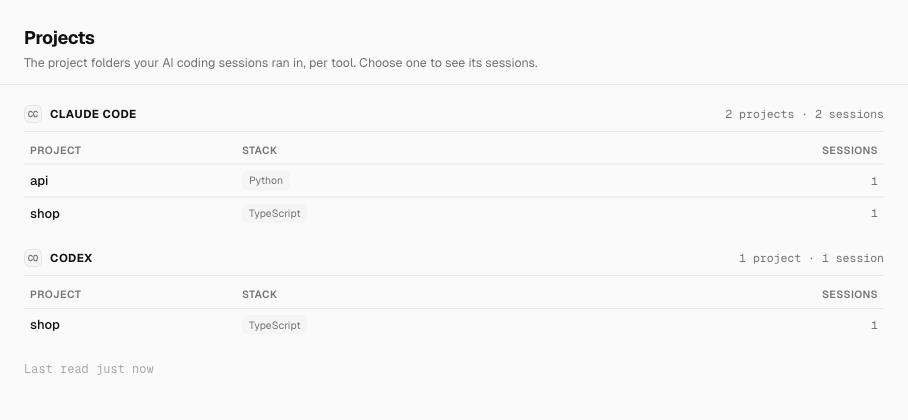
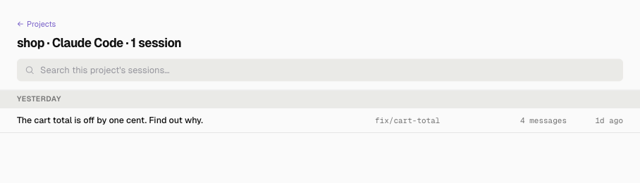
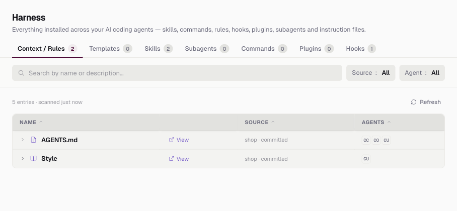

# Using the app

## What each page does

Start on Projects to find your work and read its sessions. Switch to Harness to inspect the instructions and tools your agents load.

- **Projects page:** the number of sessions per tool, for Claude Code, Cursor, GitHub Copilot, Antigravity, Codex and Kiro. Tools with no sessions are hidden. Under each tool, the project folders those sessions ran in, with a session count and the project's stack tags: the languages and tools found from files like `package.json`.
- **A project's sessions:** choose a project on the Projects page, and the page shows that tool's sessions there, under date headings, one line each with its git branch and message count. Choose a session, and the page shows its conversation, masked as the app stores it.
- **Harness page:** every skill, command, rule, hook, plugin, subagent, prompt template and instruction file that Claude Code, Codex, Cursor and Kiro load, from your home folder and every repo a session ran in. Each file shows where it lives and which agents load it.
- **File viewer:** the View button on the Harness page opens the text of an agent file it found, read-only.
- **Menu bar icon:** a click opens its menu, which shows the window, turns launch at login on or off, and quits. Cmd+Q quits too, while the window is in front. Closing the window keeps the app in the menu bar.

## Choosing a page

| You have | Use | Example |
|---|---|---|
| Sessions in several AI tools, and want to know where they ran | [The Projects page](#the-projects-page) | [count-sessions-per-tool](../examples/count-sessions-per-tool/) |
| A session you want to read again | [A project's sessions](#a-projects-sessions) | [read-a-session](../examples/read-a-session/) |
| Repos with agent files, and want to know what each agent loads | [The Harness page](#the-harness-page) | [list-agent-files-in-a-repo](../examples/list-agent-files-in-a-repo/) |
| An agent file only on your machine, not in the repo | [The Harness page's Source column](#telling-committed-local-and-user-files-apart) | [tell-committed-from-local-files](../examples/tell-committed-from-local-files/) |

Every page starts from your sessions. The Harness page scans each folder a session ran in, plus your home folder.

## Usage

### The Projects page

**When:** you want to see which tools you used, and in which projects.

Open the app and choose Projects. [Try it on sample data](../README.md#try-it-on-sample-data) prints this page for a sample home folder.

**Remember:**

- A session that ran anywhere in a repo is listed under the repo's top folder, and one in a linked worktree under its main repo.
- A session outside a repo is listed under its own folder. A Claude Code, Cursor or Antigravity session there that worked on files in a repo is listed under that repo instead. A session with no folder counts under "No folder".
- Each row stays on one line: the stack tags that fit, then "+N" for the rest, with their names on hover.

### A project's sessions

**When:** you want to read what you asked an agent, and what it answered.

On the Projects page, choose a project, search or browse its sessions, then choose one to read the conversation. Each replaces the view before it, and a back control at the top returns to it.

Masking can miss a secret in an unknown shape or another person's name in a path, so check a conversation before you share it ([details](before-you-rely-on-it.md#what-it-shows)). The [read-a-session](../examples/read-a-session/) example prints the list and one conversation for a sample home folder.

**Remember:**

- The list shows the chosen tool's sessions in that project, so it counts what the project's row counts. "No folder" lists the sessions with no folder.
- The title is the session's own title, else its first prompt, else its first message. The search box looks through this project's sessions and matches all three, not the whole conversation.
- Sessions sit under Today, Yesterday, Previous 7 days, Previous 30 days, then one heading per month, by their last activity in your time zone.
- Up and Down move through the projects or the sessions, and Enter or Space chooses one. "← Projects" or "← <project> sessions", or Escape, goes back one view, to the row you left, scrolled where it was. In the search box, the first Escape clears the search and the next goes back. A message over 500 characters shows its start, with Show more.
- A tool call in an agent's reply shows as a grey `Tool: <name>` label. Tool results and the model's thinking are not stored, so they never show. Pinned for Claude Code by `claudeCodeHiddenBlocks.test.ts`.

### The Harness page

**When:** you want to know what instructions, skills and hooks your agents get in a repo.

Choose Harness. The tabs sort the files by type, and the Source and Agent menus filter them.

The [list-agent-files-in-a-repo](../examples/list-agent-files-in-a-repo/) example prints the list for a repo with a Claude skill, an `AGENTS.md`, a Cursor rule and a Claude settings hook, as the [README](../README.md#the-harness-page) shows.

**Remember:**

- The page shows the last scan. Refresh reads again now.
- A file two agents load is listed once, with both agents. The count above the list counts entries.
- A subagent with one name for several tools in one repo or in your home folder, such as `.claude/agents/x.md` and `.codex/agents/x.toml`, is one entry with a badge per tool. View opens the first tool's file.

### Telling committed, local and user files apart

**When:** you want to know what a teammate gets from a clone, and what only you have.

The Source column says where each file lives, and so who else gets it. `<repo>` is the repo's name, `shop` in the example.

| Source | The file is |
|---|---|
| `<repo> · committed` | committed on the repo's default branch, so every clone of it gets the file |
| `<repo> · local` | not on the default branch: not committed, or committed only on another branch |
| `User` | in your home folder, so it applies in every repo, on your machine only |

The [tell-committed-from-local-files](../examples/tell-committed-from-local-files/) example prints all three, as the [README](../README.md#telling-committed-local-and-user-files-apart) shows.

More runnable examples are in [examples/](../examples/README.md). The pages' data types, with a comment on each field, are in [`src/shared/`](../src/shared/).
