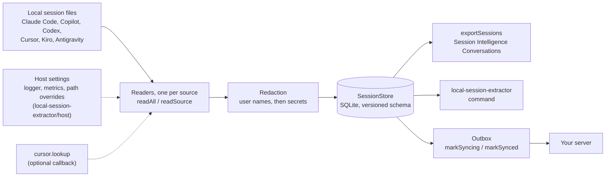
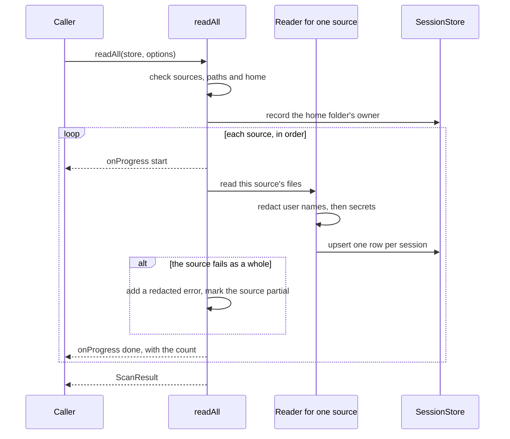

<picture>
  <source media="(prefers-color-scheme: dark)" srcset="https://raw.githubusercontent.com/tetriz-ai/agent-desk/main/packages/local-session-extractor/assets/banner-dark.svg">
  
</picture>


[](https://github.com/tetriz-ai/agent-desk/blob/main/LICENSE)


Each AI coding tool on a Mac keeps its sessions in its own format and folder, so a report or an archive across tools means writing a reader for each one, and a session copied as it is can carry secrets and your user name. local-session-extractor reads them all into one local SQLite store, with known secret shapes and your user name masked, so your code reads one store or one export, and nothing is uploaded. The export is [Session Intelligence](https://github.com/tetriz-ai/session-intelligence)'s `Conversation` format, so a session goes straight into its analysis.

## Contents

- [What it does](#what-it-does) shows how the package is built and what it leaves out.
- [Install](#install) gets the package and checks it runs.
- [Use the CLI](#use-the-cli) scans and inspects your sessions from a terminal, step by step.
- [Use the SDK](#use-the-sdk) does the same from your own code.
- [Before you rely on it](#before-you-rely-on-it) lists what to know before you run it on sessions that matter.
- [How a scan runs](#how-a-scan-runs) follows one scan from start to result.
- [Reference](#reference) points to the exact rules.
- [Project](#project) covers versioning, tests, contributing, security and license.

## What it does

The package turns each session file an AI coding tool leaves on a Mac into one normalized row. It masks secrets, email addresses in session text and your user name, then stores the row in a local SQLite file. Each tool's login email and account ids are kept as they are, as [Redaction](#redaction) says.



Use it as the `local-session-extractor` command or as a library through `openStore`, `readAll` and `exportSessions`. The outbox and the host settings are for embedding it in your own app, and [docs/reference.md](https://github.com/tetriz-ai/agent-desk/blob/main/packages/local-session-extractor/docs/reference.md) covers both. [Agent Desk](https://github.com/tetriz-ai/agent-desk/blob/main/README.md), the menu bar app in the same repository, reads its sessions through this package.

### What it does not do

- It uploads nothing. Its one network call is a probe of a local Antigravity server on 127.0.0.1, as [What a scan starts and reads](#what-a-scan-starts-and-reads) says.
- It runs on macOS only.
- It does not score, summarize or judge a session. It stores what the files say.
- It does not watch files. Run a scan again, and unchanged files are skipped.

## Install

While this repository is private, use an authenticated GitHub CLI account with repository access:

- Download with `gh release download local-session-extractor-v0.1.0 --repo tetriz-ai/agent-desk --pattern "local-session-extractor-0.1.0.tgz*"`.
- Verify with `shasum -a 256 -c local-session-extractor-0.1.0.tgz.sha256`.
- Set `LSE="file:$PWD/local-session-extractor-0.1.0.tgz"` and use that value in the examples below, skipping their public release URL assignment.

Direct release URLs work once the repository is public.

It runs on macOS with Node 24 or later. npx comes with Node. The package has no dependencies, and needs no account, service or credential.

Each release attaches the package to its GitHub Release as a `.tgz` file, and npx runs it from that file's URL.

1. **Set the URL once** in your shell, then run any command as `npx "$LSE" <command>`. npx fetches the file, asks once before it runs it, and keeps it in its cache. This prints the sources this build reads:

   ```sh
   LSE=https://github.com/tetriz-ai/agent-desk/releases/download/local-session-extractor-v0.1.0/local-session-extractor-0.1.0.tgz
   npx "$LSE" capabilities
   ```

   ```text
   Package version: 0.1.0
   Store schema version: 21
   Platforms: darwin
   Export formats: jsonl, json
   Sources, in scan order, with extractor code versions:
     claude-code  1
     copilot      1
     antigravity  1
     codex        1
     kiro         1
     cursor       1
   ```

2. **Add it to a project** to use the SDK. Add it from the same URL with pnpm:

   ```sh
   mkdir lse-try && cd lse-try
   pnpm add "$LSE"
   ```

Each version has its own URL, with the version in both the tag and the file name. Newer versions are on the [Releases page](https://github.com/tetriz-ai/agent-desk/releases?q=local-session-extractor-v&expanded=true), under tags that start with `local-session-extractor-v`. To check a downloaded `.tgz`, run `shasum -a 256 -c <file>.tgz.sha256` beside the `.sha256` the release attaches. These manually built releases include checksums but no hosted build provenance attestation.

To build it from source instead, run `pnpm install --frozen-lockfile` in a clone of [agent-desk](https://github.com/tetriz-ai/agent-desk/blob/main/README.md), which builds the package, then `node packages/local-session-extractor/dist/cli.js capabilities`.

## Use the CLI

Run these in the shell where you set `LSE` in [Install](#install). The store is `~/.local-session-extractor/sessions.db` unless you pass `--db <path>`.

1. **Scan your sessions** into the store. It prints how many sessions it wrote per source.

   It runs `ps` and runs git in every project folder your sessions name, so read [What a scan starts and reads](#what-a-scan-starts-and-reads) first. Pass `--home <dir>` to read a copied home folder instead, with no git and no `ps`.

   ```sh
   npx "$LSE" scan
   ```

   ```text
   Scanned into /Users/you/.local-session-extractor/sessions.db in 0.0s
     claude-code  1
     copilot      0
     antigravity  0
     codex        1
     kiro         0
     cursor       0
   ```

2. **Check the store.** `status` counts the sessions per source and the rows per sync state.

   ```sh
   npx "$LSE" status
   ```

3. **List the sessions**, the most recent first. Your own user name appears hashed in the session id, and the sample's `you` is a fixture user, so it stays as is.

   ```sh
   npx "$LSE" list
   ```

   ```text
     UPDATED              SOURCE       SESSION                                    PROMPTS  PROJECT
     2026-01-01 00:00:00  codex        0d6c2f4e-1b2a-4c3d-8e9f-0a1b2c3d4e5f       1        /Users/you/src/shop
     2026-01-01 00:00:00  claude-code  -Users-you-src-shop::7d3c9a10-demo-claude  4        /Users/you/src/shop
   ```

4. **Show one session** in full by its source and id, as [Session Intelligence](https://github.com/tetriz-ai/session-intelligence)'s `Conversation` JSON. A Claude Code id starts with `-`, so it goes after `--`, as in `npx "$LSE" show claude-code -- <id>`. Pass `--raw` for the row as the store keeps it.

   ```sh
   npx "$LSE" show codex 0d6c2f4e-1b2a-4c3d-8e9f-0a1b2c3d4e5f > session.json
   ```

   Session Intelligence reads that file as it is. From a clone of it, with its reference LLM service running as its README describes, analyze the session:

   ```sh
   go run ./cmd/analyze-real --url http://localhost:8000 /absolute/path/to/session.json > analysis.json
   ```

   To hand it every session at once, `export --split <folder>` writes each one as its own file, `<source>/<hash>.json`, the form its `ReadConversationDir` reads. The folder must be new or empty unless you pass `--force`.

5. **Export** every session as a Session Intelligence `Conversation`, one per line, to a file written at mode 0600 and redacted again on the way out. `--format json` writes one array instead, and `--raw` the stored rows. It still carries each tool's login email, account ids and device ids in `installationMetadata`, so treat it as personal data before you share it.

   ```sh
   npx "$LSE" export --out sessions.jsonl
   ```

6. **Reset** the store when you want to start over. It deletes every stored session, and `--yes` skips the question.

   ```sh
   npx "$LSE" reset --yes
   ```

`list` shows 20 sessions unless you pass `--limit <n>`. `reset --dedup` keeps the sessions and makes the next scan read every file again.

A command exits 0 on success, 2 when a scan finished but at least one source failed as a whole, and 1 otherwise. A single session that could not be read is reported but still exits 0. `npx "$LSE" --help` lists every flag.

## Use the SDK

`openStore()` opens the same file the command uses, and `readAll(store)` scans into it. Pass `{ home }` to read a copied home folder or `{ sources }` to pick sources. The result's `counts`, `errors` and `partial` say what was written, what could not be read and which sources failed as a whole.

Save this as `scan.mts` in the folder from [Install](#install), then run it:

```ts
import { openStore, readAll } from "local-session-extractor";

// Opens ~/.local-session-extractor/sessions.db, creating it on first use.
const store = openStore();
// Reads every tool's sessions under your home, or under a copied home folder you pass.
const home = process.argv[2];
const result = await readAll(store, home === undefined ? {} : { home });
console.log(`written: ${JSON.stringify(result.counts)}`);
const failed = Object.entries(result.partial).filter(([, partial]) => partial).map(([source]) => source);
console.log(`errors: ${result.errors.length}, failed as a whole: ${failed.join(", ") || "none"}`);
for (const row of store.listConversations({ limit: 5 })) console.log(`${row.ide_type} ${row.session_id}`);
store.close();
```

```sh
node --no-warnings=ExperimentalWarning scan.mts
```

```text
written: {"claude-code":1,"copilot":0,"antigravity":0,"codex":1,"kiro":0,"cursor":0}
errors: 0, failed as a whole: none
codex 0d6c2f4e-1b2a-4c3d-8e9f-0a1b2c3d4e5f
claude-code -Users-you-src-shop::7d3c9a10-demo-claude
```

The `--no-warnings` flag hides Node's notice that `node:sqlite` is experimental. The command hides it on its own.

`exportSessions(store, { format: "jsonl", out })` writes what the `export` command writes: one Session Intelligence `Conversation` per session, ready for its parser. `shape: "row"` writes the stored rows instead, and the `SessionIntelligenceConversation` type describes each object.

For a list of sessions and their messages, `store.listSessionSummaries()` returns one page of sessions without their text, and `store.getConversationPage(row.id)` returns one page of a session's messages. Neither returns the login email or the account ids. [docs/reference.md](https://github.com/tetriz-ai/agent-desk/blob/main/packages/local-session-extractor/docs/reference.md#the-store-openstore-and-sessionstore) lists their fields.

[examples/README.md](https://github.com/tetriz-ai/agent-desk/blob/main/packages/local-session-extractor/examples/README.md) matches eight tasks to runnable examples, such as syncing rows to your own server, exporting safely and wiring a logger. They run from this folder in a clone of [agent-desk](https://github.com/tetriz-ai/agent-desk/blob/main/README.md), after `pnpm install --frozen-lockfile` at the repository root, which also builds the package.

## Before you rely on it

Each item below is pinned by the named test.

### Redaction

- **Passes through unmasked (can leak).**
  - An export carries the installation metadata as stored (`installationMetadata`, or `installation_metadata` in a row export), with each tool's login email, account ids and device ids. This is by design, so treat an export as personal data before you share it. Pinned by `src/store/__tests__/outboxContract.test.ts` ("is exported as stored").
  - A secret in a shape no pattern knows, written as a plain word, stays in the text. Pinned by `src/redaction/__tests__/limits.test.ts`.
  - Another person's name inside a path is kept unless it is your user name or the owner of a scanned home. Pinned by `src/redaction/__tests__/anonymizer.test.ts` ("does not anonymize other users' paths").
  - A token used as the user name with no `:`, as in `https://<token>@host`, is masked only when it reads as an email address, so on a dotless host it stays. Pinned by `src/redaction/__tests__/secretShapes.test.ts` ("masks a colon-less token user only when it reads as an email address").
  - The store keeps branch names as the readers wrote them, even one holding your user name. An export redacts every string but the installation metadata, so a user name inside a branch, model or agent name is hashed there. Pinned by `src/redaction/__tests__/limits.test.ts` ("keeps branch names in the stored row") and `src/__tests__/exportFullRedaction.test.ts` ("hashes the running user's name in a branch name").
  - The store keeps Claude Code session ids raw, such as `-Users-alice-app::<id>`, and records scanned home owners' names, so a copied `.db` file carries them. Only `export`, `list` and `show` hash them. Pinned by `src/__tests__/contractPins.test.ts` ("the store at rest").
- **Masks more than it should (harmless).**
  - A quoted string that looks random, such as an id, is masked as a secret. Pinned by `src/redaction/__tests__/secrets.test.ts` ("redacts high-entropy quoted strings").
  - A quoted home path can be masked whole once the name in it is hashed. Pinned by `src/redaction/__tests__/limits.test.ts` ("can mask a quoted home path whole").
- **Restores less than it hid.** `unredactPath`, the SDK function that puts your home path back into a redacted path, restores a dash-encoded home only in Claude Code's encoding, where every character other than a letter or digit is a dash. Pinned by `src/redaction/__tests__/limits.test.ts` ("restores a dash-encoded home").

### What a scan starts and reads

- **Starts `ps` and calls a local server.** A scan without `home` runs `ps` once to find a running Antigravity server, then sends HTTPS requests to it on 127.0.0.1 and nowhere else. With `home`, it runs no `ps` and makes no request. Pinned by `src/__tests__/networkDisclosure.test.ts`.
- **Runs git in your projects.** A scan without `home` runs git in every project folder a session names, and that git reads the repository's own settings. It ignores the `GIT_*` variables in your environment except `GIT_CONFIG_GLOBAL`, `GIT_CONFIG_SYSTEM` and `GIT_CONFIG_NOSYSTEM`, which only choose the config files it reads. It does not rewrite the index, and runs no fsmonitor, `post-index-change` hook, external diff, textconv or `log.showSignature` signature check. It still runs a filter driver the repository's `.gitattributes` names (`filter.<name>.clean` or `.process`) when it diffs a changed file. Scan only projects you trust, or pass `home`, which runs no git. Pinned by `src/extractors/__tests__/gitRepoControl.test.ts`, and the `home` case by `src/__tests__/readAll.test.ts` ("spawns no git process in a scanned repository").
- **Reads login files.** A scan reads four login files for account details, and keeps no token from any of them. Pinned by `src/__tests__/credentialFiles.test.ts` for the first two.
  - Claude Code's `~/.claude.json`, its `oauthAccount` part only: the email, the account and organization ids, the seat tier, the organization type and role, the billing type, the rate-limit tiers, the subscription start and the extra-usage flag.
  - Codex's `auth.json`: the login email and plan.
  - Kiro's login database: the login email and plan.
  - Cursor's CLI config, `~/.cursor/cli-config.json`: the login email.
- **Hands a Cursor token to your code only if you ask.** With `cursor.lookup` set, a scan reads the Cursor access token from Cursor's local database and passes it to your callback. Without it, no callback runs and nothing is fetched. Pinned by `src/__tests__/readAll.test.ts` ("the Cursor seat-tier gate").

### Coverage

- **Misses.** Vendors change their file formats without notice. A record kind the reader does not know is counted in `unknownRecordKinds`, not read. Pinned by `src/__tests__/readAll.test.ts` ("counts unrecognized record kinds").
  - Codex 0.118 and later record a command's result in a form the reader does not take counts from. For those sessions, the files read, failed commands, and the commits, pushes and pull requests that the reader would otherwise count from command output are missing. Their prompts, replies and tool timeline are read.
- **Reads too much.** None known.

## How a scan runs



A scan first checks its options and throws before reading anything when one is wrong. It then records the owner of the home folder it reads, so a later export hashes that name too.

Each source runs in turn, and a source that fails is marked partial while the next one still runs. The result carries the counts, the errors, the partial sources and any record kinds the readers did not know.

## Reference

[docs/reference.md](https://github.com/tetriz-ai/agent-desk/blob/main/packages/local-session-extractor/docs/reference.md) holds the exact rules for scan options, the store, the export, the redaction patterns, the metrics and every command-line flag.

## Project

### Versioning and compatibility

The package is at v0.1.0 and follows semantic versioning. A change to an exported signature, a store column or an export field is breaking. Before 1.0, the store schema, the export fields and the function signatures may change in a minor release.

### Tests

`pnpm test` runs the whole suite offline. A test-wide guard gives every test an empty temp home, blocks `ps` and HTTPS, and ignores your git settings.

`scripts/smoke-install.sh` installs the packed package and compares a scan of the fixture homes with `fixtures/golden.jsonl` and `fixtures/golden-conversation.jsonl`. Run every example locally through `scripts/run-examples.sh`; GitHub Actions is disabled.

### Contributing, security and license

- Read [CONTRIBUTING.md](https://github.com/tetriz-ai/agent-desk/blob/main/CONTRIBUTING.md) to build, test and lint. Every pull request needs a test.
- Report a vulnerability privately through GitHub's [private vulnerability reporting](https://github.com/tetriz-ai/agent-desk/security/advisories/new), never in a public issue. [SECURITY.md](https://github.com/tetriz-ai/agent-desk/blob/main/SECURITY.md) has the policy.
- The code is under the MIT License, in [LICENSE](https://github.com/tetriz-ai/agent-desk/blob/main/LICENSE). Parts of the redaction code are adapted from Dataclaw, and [NOTICE](https://github.com/tetriz-ai/agent-desk/blob/main/NOTICE) records its license.

Copyright 2026 Workloom Solutions Private Limited.

Contributors are listed in [CONTRIBUTORS.md](https://github.com/tetriz-ai/agent-desk/blob/main/CONTRIBUTORS.md).
